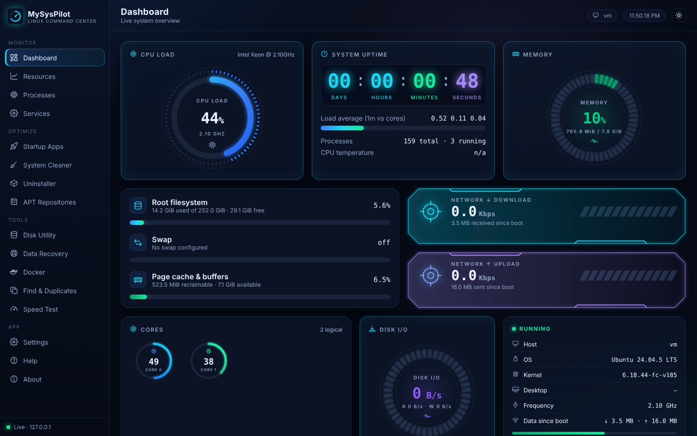
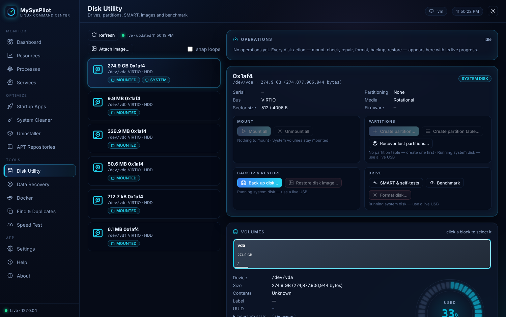
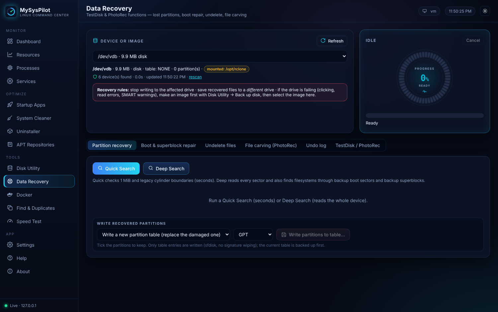
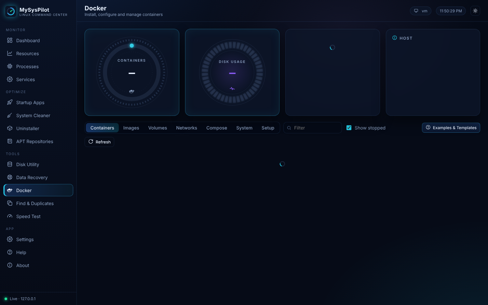
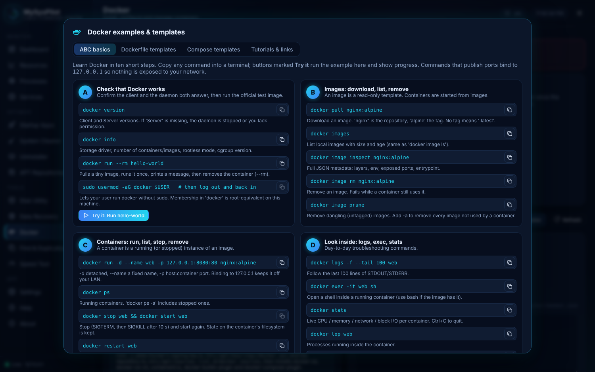
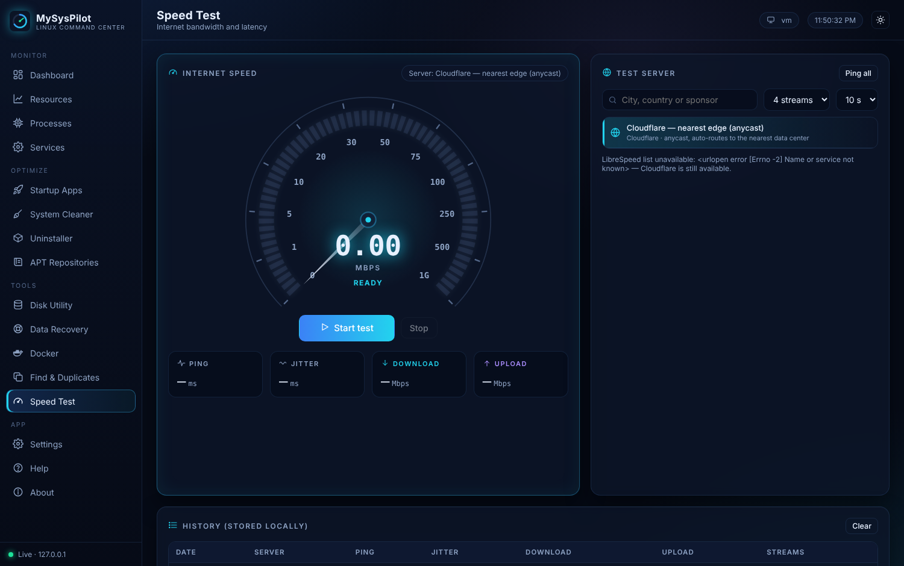
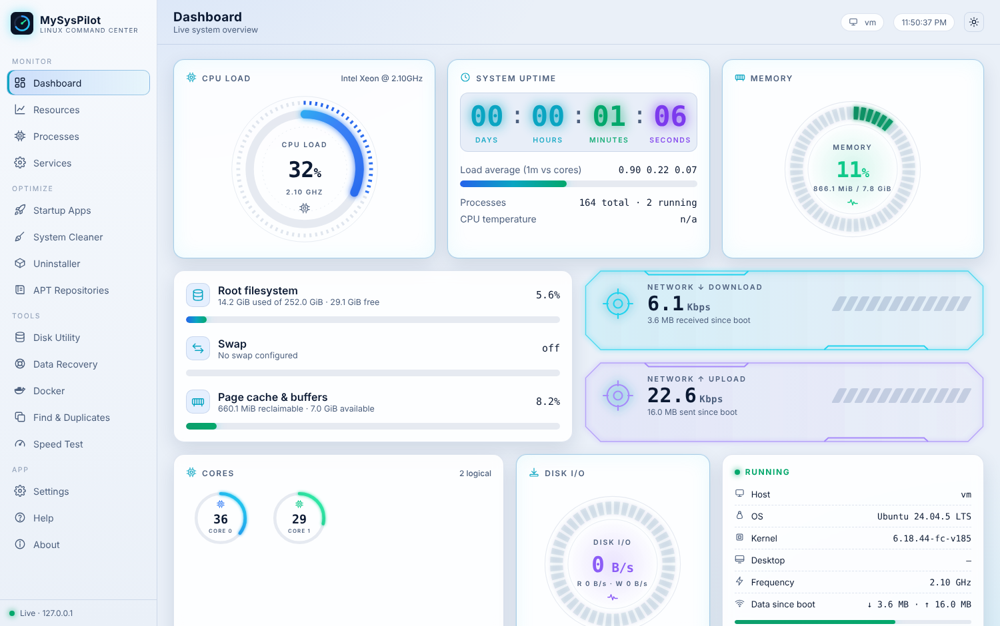

# MySysPilot

**Linux system optimizer, monitor, disk utility, data recovery and Docker manager — one local dashboard.**

MySysPilot is a single Python 3 program (standard library only) that serves a neon dashboard on `127.0.0.1`. It covers what [Stacer](https://github.com/oguzhaninan/Stacer) does, adds a GNOME Disks–style disk utility, TestDisk/PhotoRec-style data recovery, Docker administration, a duplicate finder and an internet speed test.



## Features

| Area | What it does |
|---|---|
| **Monitor** | Live CPU (per core), memory, swap, disk I/O, network, sensors, uptime, load; resource history graphs |
| **Processes / Services / Startup** | Search, sort, renice, signal and kill processes; start/stop/enable systemd units; manage autostart entries |
| **System Cleaner** | APT cache, old logs, journal vacuum, user caches, trash, disabled snap revisions |
| **Uninstaller / APT repositories** | Remove APT, Snap and Flatpak packages; enable, disable, add and remove repositories |
| **Disk Utility** | Mount/unmount, check & repair (with live fsck progress), create/delete/resize partitions, format, LUKS, SMART & self-tests, benchmark, attach disk images, drive health badges (OK · mounted · needs repair · I/O errors) |
| **Backup & Restore** | Disk/partition images (zstd/gzip), file archives, SHA-256 verification, partition-table backups, throughput graph and ETA |
| **Data Recovery** | Quick/deep lost-partition search and table rewrite, NTFS/FAT/exFAT/ext boot & superblock repair (with undo log), NTFS/FAT undelete, file carving by signature |
| **Docker** | Install Docker Engine, manage containers, images, volumes, networks and Compose projects; build images; **Examples & Templates** (ABC basics, Dockerfile and Compose templates, tutorial links) |
| **Find & Duplicates** | Duplicate finder (size → partial hash → full hash) and file-name / text-content search |
| **Speed Test** | Cloudflare and LibreSpeed servers, server selection by ping, download/upload/latency/jitter gauges, history |
| **App** | Dark/light theme, help, operation tracker with progress for every long task, single-instance handling |

## Screenshots

| | |
|---|---|
|  |  |
|  |  |
|  |  |

## Install

Download `mysyspilot_<version>_all.deb` from [Releases](../../releases), then:

```bash
cp ~/Downloads/mysyspilot_*_all.deb /tmp/
sudo apt install /tmp/mysyspilot_*_all.deb
mysyspilot          # or open "MySysPilot" from the application menu
```

Installing from `/tmp` avoids apt's harmless "_apt couldn't access file" notice for files in your home folder.

**Without installing:** download `MySysPilot_v<version>.py` from Releases and run `python3 MySysPilot_v<version>.py` (add `--install-desktop` once for a menu launcher).

Tested on Ubuntu 24.04 LTS. Requires Python ≥ 3.8. Recommended packages (pulled in by apt): `udisks2`, `python3-gi`, `pkexec`, `smartmontools`, `e2fsprogs`, `fdisk`, `zstd`, `xdg-utils`.

## Security model

- Listens on **127.0.0.1 only**. Every API call needs a random per-launch token; the Host header is checked (blocks DNS rebinding / CSRF from other pages); a strict Content-Security-Policy is set.
- **Never run it with sudo.** Privileged actions are authorized one at a time through polkit — UDisks2 for disk operations, `pkexec` for the rest, and the polkit action `com.mysyspilot.diskhelper` for raw-disk access in Data Recovery (helper: `/usr/libexec/mysyspilot/msp-diskhelper`, block devices only).
- Destructive actions (format, delete, partition-table writes, restore) require explicit confirmation; system disks are protected from destructive operations while the system runs from them.

## Network and privacy

No telemetry, no analytics, no update checks. Network access happens only through user actions:

- **Speed Test** page: downloads the LibreSpeed server list (librespeed.org) and pings those servers; a test contacts the chosen server (Cloudflare or LibreSpeed).
- **APT / Snap / Flatpak / Docker** operations contact their configured repositories or registries.
- Links in Docker → Examples & Templates → Tutorials open in your browser only when clicked.

Per-user data lives in `~/.local/share/mysyspilot/` (mode 0700): speed-test history, filesystem check status, backup catalog, recovery undo logs, and `instance.json` (port and session token of the running server, mode 0600).

## Command line

```
mysyspilot [--port N] [--no-browser] [--new-instance]
mysyspilot --install-desktop
```

See `man mysyspilot`.

## Build from source

```bash
# single-file program
python3 src/build.py build/mysyspilot.py

# Debian package (Ubuntu 24.04: sudo apt install debhelper devscripts)
dpkg-buildpackage -us -uc          # → ../mysyspilot_<version>_all.deb
lintian -EIL +pedantic ../mysyspilot_*_amd64.changes
```

| Path | Contents |
|---|---|
| `src/backend.py` | HTTP server, API, system/disk/recovery/Docker logic |
| `src/ui.html` | Web UI (HTML, CSS, JavaScript) |
| `src/dkx_data.py` | Docker examples, templates and tutorial links (injected into the UI at build time) |
| `src/build.py` | Embeds the UI into the backend → one `.py` file |
| `data/` | Launcher, polkit policy, root disk helper, desktop entry, icon, AppStream metainfo, man page |
| `debian/` | Debian packaging (debhelper 13, `3.0 (native)`) |

## Disclaimer

Partitioning, formatting, repair and data-recovery functions can cause permanent data loss if misused. Back up first, and work on a disk image when recovering data from a failing drive.

## License

Proprietary — see [LICENSE](LICENSE). © 2026 Gus Salazar.
